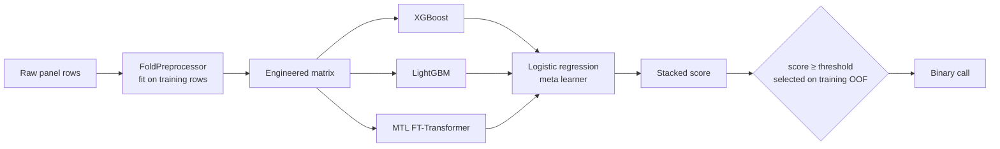
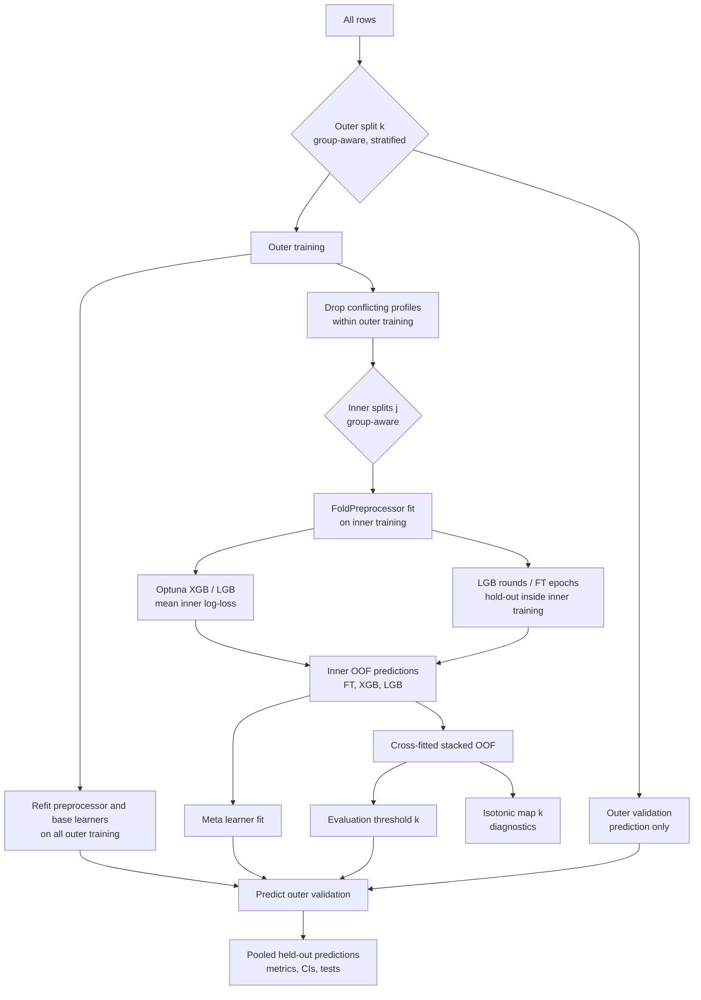

**English** | [Türkçe](README_TR.md)

# VarPath — Missense Variant Pathogenicity Classification

A tabular machine-learning pipeline that scores missense variants as pathogenic or benign. It combines engineered amino-acid, structural and topological descriptors with gradient-boosted trees, a multi-task FT-Transformer and a logistic-regression stacker. All of it is evaluated with nested, group-aware cross-validation.

> **For research and educational purposes only. Not intended for clinical diagnosis, treatment, or medical decision-making.**

---

## Contents

1. [Research purpose](#research-purpose)
2. [Competition context](#competition-context)
3. [Problem definition](#problem-definition)
4. [Dataset](#dataset)
5. [Feature engineering](#feature-engineering)
6. [Model architecture](#model-architecture)
7. [Evaluation protocol](#evaluation-protocol)
8. [Repository structure](#repository-structure)
9. [Installation](#installation)
10. [Usage](#usage)
11. [Reproducibility and hardware](#reproducibility-and-hardware)
12. [Results](#results)
13. [Methodological revision](#methodological-revision)
14. [Limitations](#limitations)
15. [Disclaimer](#disclaimer)
16. [Future work](#future-work)
17. [References](#references)

---

## Research purpose

The project began as my competition prototype. This repository turns it into a reproducible study that asks one question:

> How well does a fixed feature set and model family separate pathogenic from benign missense variants when every modelling decision is made without access to the evaluation data?

The emphasis is on a defensible performance estimate rather than on a high score. The feature engineering and model family of the prototype are kept. The evaluation around them was rebuilt (see [Methodological revision](#methodological-revision)).

## Competition context

I built this as a personal project for the **TEKNOFEST 2026 Healthcare Artificial Intelligence (Sağlıkta Yapay Zeka)** competition, which provided four labelled training tables, one per gene panel. All code here is my own work. My original notebook, which ran on a Colab A100 GPU, is archived in [`notebooks/legacy_competition_notebook.ipynb`](notebooks/legacy_competition_notebook.ipynb) together with an audit note.

## Problem definition

- **Input:** one row per variant. It holds several hundred anonymised numeric annotations, a few categorical annotations, the reference and alternative amino acids, and the panel the row comes from.
- **Output:** a score in [0, 1] and a binary call (1 = pathogenic, 0 = benign), obtained with a threshold selected on training data.
- **Target of the evaluation:** discrimination (ROC-AUC, PR-AUC) and threshold-dependent behaviour with a sensitivity-oriented operating point (F2 under a specificity constraint).

## Dataset

The competition tables are **not included** in this repository. No licence or redistribution permission accompanied them, so the file paths are listed in `.gitignore`. Place the four CSV files in `data/` (or pass `--data-dir`) to reproduce the experiments. The expected layout is documented in [`examples/DATA_SCHEMA.md`](examples/DATA_SCHEMA.md). An artificial example with the same columns is provided in [`examples/synthetic_sample.csv`](examples/synthetic_sample.csv).

### Panel counts

| Panel | Rows | Pathogenic | Benign | Positive rate |
|---|---:|---:|---:|---:|
| MASTER | 2931 | 2149 | 782 | 0.73 |
| KANSER (cancer) | 388 | 268 | 120 | 0.69 |
| PAH | 372 | 310 | 62 | 0.83 |
| CFTR | 111 | 90 | 21 | 0.81 |
| **Total** | **3802** | **2817** | **985** | 0.74 |

### Characteristics that shape the evaluation

- **Columns:** 334 `AL_*` and 9 `EK_*` numeric annotations (about 55 % missing, 57 of them constant), 6 `CAT_*` categorical columns, and `AA_1`/`AA_2`. The columns are anonymised.
- **No gene, protein or transcript identifier.** Column names and string values were scanned for gene symbols, HGNC, UniProt, Ensembl and RefSeq patterns, and none were found.
- **Cross-panel duplicates.** 578 rows of the KANSER, PAH and CFTR tables carry a `Variant_ID` that also occurs in MASTER. These rows share the label and residue change, but their annotations are slightly perturbed. There are 3224 distinct variants.
- **Empty rows.** 137 rows have no numeric information at all, and their labels conflict.

## Feature engineering

All transforms below are implemented in `src/varpath/features/`. Anything that learns from data is fitted inside `FoldPreprocessor` on the training partition only.

| Block | Features | Description |
|---|---:|---|
| Original numeric | variable (≈286 after dropping constants) | `AL_*`, `EK_*`; MICE imputation (`IterativeImputer`, 20 nearest features) followed by `RobustScaler` |
| Amino-acid physicochemical | 24 | Hydropathy, pI, molecular weight, volume, polarity, charge, aromaticity and flexibility for the reference residue, the alternative residue and their difference |
| BLOSUM62 | 1 | Substitution score (Henikoff & Henikoff, 1992) |
| Grantham distance | 1 | Physicochemical distance (Grantham, 1974) |
| Structural descriptors | 18 | Chou–Fasman helix/sheet/turn propensities, relative solvent accessibility and a rigidity index for both residues, their differences, and disruption / helix-change / sheet-change scores |
| TDA | 13 | The row's numeric profile is treated as a 1-D signal, delay-embedded in 2-D and passed to Vietoris–Rips persistent homology (`ripser`). The features are finite-bar counts for H0 and H1, their difference, and the mean, max, entropy, total and standard deviation of persistence for H0 and H1. Gaps are filled with training-fold medians. |
| Missingness | variable | Binary "is missing" flags, kept when their mutual information with the **training** labels exceeds 0.001 |
| Categorical | variable | One-hot encoding of `CAT_*` (`min_frequency=3`, unknown levels ignored) |

The output order is `numeric → amino-acid + structural → TDA → missingness → categorical`. The feature names are persisted with the model, and a test checks that their count equals the width of the transformed matrix.

## Model architecture



- **XGBoost** uses the `hist` tree method, `scale_pos_weight = 1.5 × neg/pos`, and an Optuna TPE search over the number of trees, learning rate, depth, subsampling, column sampling and L1/L2 penalties. The depth is capped by the prototype rule (sample/feature ratio; cap of 3 when CFTR rows make up more than 1 % of the training data).
- **LightGBM** uses the same search space plus `num_leaves`. Row subsampling is made effective with `subsample_freq=1`. Early stopping runs on an inner hold-out, and the final number of rounds is the median of the inner best iterations.
- **MTL FT-Transformer** (Gorishniy et al., 2021) tokenises each feature and prepends a CLS token. A pre-norm Transformer encoder follows (standard profile: `d_token=32`, 4 heads, 2 layers, dropout 0.3). Two heads sit on top: pathogenicity (BCE with `pos_weight` and label smoothing 0.1) and panel membership (cross-entropy). The losses are mixed with α = 0.7. Training uses AdamW (lr 3e-4) with a cosine schedule. An optional `token_budget` keeps the k features with the highest training-fold ANOVA F-scores, which is used in the CPU `quick` profile.
- **Stacking** fits a logistic regression on genuine out-of-fold predictions of the three base learners (column order FT, XGB, LGB).

## Evaluation protocol

### Nested cross-validation



The standard profile uses **5 outer × 3 inner** folds with a fixed seed (42). The whole training procedure is a single function, `fit_stacked_pipeline`, which is called once per outer fold and never receives outer-validation rows. The deployment model is produced by calling the same function on all rows.

### Group-aware splitting

- **Grouping variable:** `Variant_ID`, configured in `grouping.column`. The data contain no gene, protein or transcript identifier (see [Dataset](#dataset)), so the strongest available entity is the variant itself. Grouping on it keeps the 578 cross-panel duplicates on one side of every split.
- **What this is:** a **variant-level held-out evaluation**.
- **What this is not:** a gene-held-out evaluation. Variants of the same gene can appear in both training and evaluation folds, so performance on unseen genes is not measured.
- **How splits are formed:** folds are stratified by label × panel when feasible. The code falls back to label-only stratification, and then to a shuffled `GroupKFold`, when needed.
- **Enforced disjointness:** every outer split, inner split and early-stopping hold-out is checked for group disjointness, and the run stops with `GroupLeakageError` otherwise. `outputs/*/group_audit.json` records the grouping and the per-fold intersections.
- **Sensitivity grouping:** the prototype's duplicate-profile hash grouping is still available as `configs/sensitivity_row_hash.yaml`. It is a sensitivity analysis, not a held-out evaluation.

### Leakage prevention

| Step | Where it is fitted |
|---|---|
| Numeric typing, constant-column removal | training partition |
| MICE imputation, robust scaling | training partition |
| TDA gap filling (medians), TDA scaling | training partition |
| Missing-indicator selection (uses labels) | training partition |
| One-hot encoders | training partition |
| Conflict removal | training partition (validation rows are never removed) |
| Class weights | training partition |
| XGBoost / LightGBM hyperparameters | inner folds |
| LightGBM rounds, FT-Transformer epochs | hold-out inside inner training folds |
| Meta learner | inner OOF predictions |
| Decision threshold | cross-fitted inner OOF predictions |
| Recalibration map (diagnostic) | cross-fitted inner OOF predictions |

The test suite enforces these properties. Among other checks, it flips all outer-validation labels and verifies that the fold's thresholds, hyperparameters, meta-learner coefficients and held-out predictions stay identical. A separate test replaces XGBoost with a memorising model to show that no inner OOF prediction comes from a model that saw the row.

### Threshold-selection protocol

The rule is kept from the prototype: take the smallest score threshold that maximises F2 while specificity is at least 0.60.

- **Evaluation thresholds** (`evaluation_fold_thresholds`): one per outer fold. Each is chosen on that fold's training-side cross-fitted stacked OOF predictions and applied unchanged to the fold's held-out rows. Binary metrics are computed from these fixed calls.
- **Deployment threshold** (`deployment_threshold`): chosen in the same way when the model is fitted on all rows, and stored in `artifacts/*/manifest.json`. It is used for inference only and is never used to report performance.

No threshold is tuned on held-out rows, whether for the whole set, a fold or a panel.

### Evaluation metrics

The following metrics are computed on pooled outer held-out predictions:

- **Threshold-free:** ROC-AUC, PR-AUC (average precision) and Brier score.
- **Threshold-dependent** (from fold-threshold calls): F1, F2, sensitivity, specificity, precision, NPV, MCC, balanced accuracy, accuracy and the confusion matrix.

Per-fold values are in `fold_metrics.csv`. Per-panel values are in `panel_metrics.csv`, which carries the sample counts and a reliability label: *single-class (AUC not defined)*, *exploratory (n < 30)*, *exploratory (< 10 in minority class)* or *reportable*. A near-perfect AUC is flagged rather than highlighted.

### Bootstrap confidence intervals

Percentile intervals (95 %, 1000 replicates in the standard profile) are computed around point estimates on the full held-out set.

- The **resampling unit is the group** (`Variant_ID`), which accounts for the correlation between duplicated variants.
- Probabilities and binary calls are resampled as they are. No threshold is re-optimised inside a replicate.
- The intervals do not include the variability of re-running the training procedure.

### DeLong test

A fast DeLong test (Sun & Xu, 2014) compares paired ROC-AUCs on the pooled held-out probabilities: XGB vs LGB, XGB vs stack, LGB vs stack and FT vs stack. A Bonferroni-adjusted α is reported. The test assumes independent rows, which variant grouping satisfies only approximately.

### McNemar test

The McNemar test is applied to the held-out binary calls, each produced with the model's own training-selected fold thresholds. Both the continuity-corrected χ² p-value and an exact binomial p-value are given.

### Calibration

- **Raw diagnostics:** Brier score, expected calibration error (10 bins) and reliability curves on held-out probabilities.
- **Train-side recalibration:** an isotonic map is fitted on each outer fold's training-side cross-fitted predictions and applied to that fold's held-out scores. The result is reported as `stack_recalibrated`.
- **Decision rule:** decisions use the raw stacked score, so the threshold and the calibration analysis stay separate.

### Decision curve analysis

Net benefit (Vickers & Elkin, 2006) of each model is computed on held-out probabilities over threshold probabilities from 0.01 to 0.80, against "treat all" and "treat none". This is a descriptive analysis of a research model, not a clinical utility claim.

### Explainability (SHAP)

Exact TreeSHAP contributions are computed from the **deployment XGBoost base learner**, the model refitted on all data. No fold model is chosen for its validation score.

- **Summary plot:** contributions are computed on a random sample of training rows (`shap.n_samples`).
- **Per-row explanations:** at inference, contributions are computed on exactly the matrix that the model scores. Tests check width, feature order and additivity (contributions plus bias equal the model margin).
- **Scope:** the explanations describe the XGBoost component, not the full stack.

### Exploratory analyses (outside the primary estimate)

- **Panel-specific fine-tuning:** *Panel-specific fine-tuning is exploratory and is not included in the primary unbiased performance estimate.* Within each outer fold, the prototype's panel rules are applied to outer-training rows of that panel: continued boosting, with a small model on the top 50 features for CFTR. The results are scored threshold-free on the same panel's held-out rows (`exploratory_panel_finetune.csv`).
- **Variant similarity network:** a visual summary only.

## Repository structure

```text
varpath/
├── README.md / README_TR.md
├── pyproject.toml, requirements.txt
├── configs/            quick.yaml, standard.yaml, full.yaml, sensitivity_row_hash.yaml
├── src/varpath/
│   ├── config.py       typed YAML configuration
│   ├── data.py         loading, grouping, group audit
│   ├── features/       amino_acid, structural, tda, preprocessing (FoldPreprocessor)
│   ├── models/         gbdt (tuning), ft_transformer, stacking (fit_stacked_pipeline)
│   ├── evaluation/     splits, nested_cv, thresholding, metrics, statistics,
│   │                   calibration, dca, summary, exploratory
│   ├── reporting/      plots, report (JSON/CSV writers, research PDF)
│   ├── artifacts.py    save/load, VariantPredictor
│   ├── pipeline.py     end-to-end run
│   ├── synthetic.py    artificial data with the same layout
│   └── cli.py          train / evaluate / predict entry points
├── scripts/            train.py, evaluate.py, predict.py, make_synthetic_data.py
├── app.py              Gradio demo (loads persisted artifacts)
├── tests/              unit tests and a tiny end-to-end smoke test
├── examples/           synthetic_sample.csv, DATA_SCHEMA.md
├── notebooks/          legacy_competition_notebook.ipynb (archived, audited)
└── outputs/            run outputs (git-ignored)
```

## Installation

Python ≥ 3.10.

```bash
git clone <repo-url> varpath && cd varpath
python -m venv .venv && source .venv/bin/activate
# CPU-only PyTorch (optional, smaller download):
pip install torch --index-url https://download.pytorch.org/whl/cpu
pip install -e ".[dev,app]"
pytest -q
```

## Usage

### Data preparation

```text
data/
├── YARISMA_TRAIN_MASTER.csv
├── YARISMA_TRAIN_KANSER.csv
├── YARISMA_TRAIN_PAH.csv
└── YARISMA_TRAIN_CFTR.csv
```

Without the competition files, artificial panels can be generated with:

```bash
python scripts/make_synthetic_data.py --out-dir data/synthetic
python scripts/train.py --config configs/quick.yaml --data-dir data/synthetic
```

### Training

```bash
# nested evaluation + deployment model
python scripts/train.py --config configs/standard.yaml --data-dir data

# evaluation only
python scripts/train.py --config configs/standard.yaml --skip-deployment

# ad-hoc overrides
python scripts/train.py --config configs/quick.yaml --set cv.outer_folds=5 --set compute.n_jobs=4
```

### Configuration profiles

| Setting | `quick` | `standard` | `full` |
|---|---|---|---|
| Outer × inner folds | 3 × 2 | 5 × 3 | 5 × 5 |
| Optuna trials (XGB / LGB) | 5 / 5 | 10 / 10 | 25 / 25 |
| Tree range | 100–400 | 100–700 | 100–700 |
| FT `d_token`, max epochs, patience | 32, 15, 4 | 32, 30, 5 | 64, 50, 10 |
| FT batch / token budget | 128 / 128 features | 128 / all | 64 / all |
| Bootstrap replicates | 200 | 1000 | 2000 |
| SHAP samples | 100 | 300 | 500 |
| Panel fine-tuning (exploratory) | off | on | on |
| Intended hardware | laptop CPU | CPU (slow) or one consumer GPU | GPU |


A fourth profile, `configs/quick_cpu.yaml`, is the quick profile with a further reduced transformer budget (8 epochs, 96 tokens, single worker). It is the configuration of the run reported under [Results](#results) and completes on one CPU core in about 13 minutes.
Every output directory contains `config_used.yaml` and `run_info.json` (profile, seed, library versions, git commit). The results below always state their profile.

### Evaluation

```bash
python scripts/evaluate.py --output-dir outputs/standard
```

This recomputes all metrics, tests and figures from `oof_predictions.csv` without retraining.

Outputs:

| File | Content |
|---|---|
| `metrics.json` | protocol, pooled held-out metrics with bootstrap CIs, calibration, threshold spread |
| `fold_metrics.csv` | per-outer-fold metrics for each model |
| `panel_metrics.csv` | per-panel metrics with sample counts and reliability labels |
| `thresholds.json` | `evaluation_fold_thresholds`, `deployment_threshold` |
| `statistical_tests.csv` | DeLong and McNemar comparisons |
| `group_audit.json` | grouping description and per-fold group intersections |
| `oof_predictions.csv` | pooled held-out probabilities, thresholds, calls |
| `fold_details.json` | per-fold hyperparameters, epochs, meta coefficients, timings |
| `decision_curve.csv`, `shap_importance.csv`, `exploratory_panel_finetune.csv` | supporting tables |
| `figures/` | ROC/PR, calibration, threshold analysis, panel comparison, DCA, SHAP, network |

### Inference

```bash
python scripts/predict.py --artifacts artifacts/standard \
    --input new_variants.csv --output predictions.csv --explain 5 --report-dir reports/
```

```python
from varpath.artifacts import load_artifacts
predictor = load_artifacts("artifacts/standard")
scores = predictor.predict(df)          # score, predicted_label, base-model scores
top = predictor.explain(df, top_k=5)    # TreeSHAP of the XGBoost component
```

- **Input:** must contain every numeric column seen in training plus `AA_1`/`AA_2`. Missing columns are rejected, not imputed.
- **Artifact contents:** the preprocessor (imputer, scalers, encoders, selected indicators), the three base learners in native formats, the meta learner, the deployment threshold, the feature schema, grouping metadata, the full configuration, the seed, library versions and SHA-256 checksums.

### Gradio demo

```bash
python app.py --artifacts artifacts/standard
```

- **Full-model prediction:** upload a CSV that follows the training schema (for example `examples/synthetic_sample.csv`). Each row is scored by the complete persisted pipeline with the deployment threshold. The page shows TreeSHAP contributions of the XGBoost component and can produce a research PDF.
- **Amino-acid substitution explorer:** shows descriptors of a residue change. *This mode is illustrative only and does not represent a full model prediction.*

The demo loads everything from disk and does not depend on notebook state.

## Reproducibility and hardware

- **Determinism:** a fixed seed drives the splits, Optuna samplers, imputers, boosters and PyTorch. Child seeds are derived per fold.
- **Imputation:** it is deterministic (`sample_posterior=False`), so a row's features do not depend on the other rows in a batch.
- **Verification:** tests check that identical seeds give identical splits and predictions, and that save → load reproduces the scores exactly.
- **Remaining non-determinism:** on GPU, some cuDNN kernels can still introduce small non-deterministic differences.
- **Compute reductions** compared with the prototype:
  - Search budget per profile: 10 trials instead of 25.
  - FT-Transformer: `d_token` 32 instead of 64, early stopping with patience, and an optional token budget.
  - Pruning: Optuna median pruning across inner folds.
  - Caching: TDA results are cached per unique filled signal.
  - Precision and inference: float32 matrices, mixed precision on CUDA, and `torch.inference_mode` for inference.
  - Parallelism: the worker count is configurable (`compute.n_jobs`).
- **Hardware:** no step requires an A100. The `quick` profile runs on a single CPU core (see [Results](#results) for measured time). For the `standard` profile a consumer GPU is recommended because the FT-Transformer attends over all ≈700 feature tokens. It also runs on CPU, only more slowly.

## Results

<!-- RESULTS-START -->
### Corrected nested cross-validation (executed run)

**Evaluation protocol**

```text
3 outer folds x 2 inner folds, group-aware (stratified by label x panel)
Group variable: Variant_ID (variant-level held-out; not gene-held-out)
Config: configs/quick_cpu.yaml   Profile: quick-cpu   Seed: 42
Estimate: pooled outer held-out predictions of 3802 rows / 3224 groups
Thresholds: selected per fold on outer-training OOF predictions (0.562, 0.595, 0.607)
```

| Metric | Nested group-CV estimate | 95 % CI (group bootstrap) |
|---|---|---|
| ROC-AUC | 0.8518 | 0.8346 – 0.8669 |
| PR-AUC | 0.9293 | 0.9181 – 0.9389 |
| F2 | 0.8984 | 0.8883 – 0.9092 |
| MCC | 0.5563 | 0.5256 – 0.5910 |
| Sensitivity | 0.9042 | 0.8916 – 0.9161 |
| Specificity | 0.6345 | 0.6039 – 0.6593 |
| Balanced accuracy | 0.7693 | 0.7521 – 0.7861 |
| F1 | 0.8899 | — |

Confusion matrix over all held-out rows (fold thresholds): TP 2547, FP 360, TN 625, FN 270.

**Base learners on the same held-out predictions**

| Model | ROC-AUC | PR-AUC | F2 | MCC |
|---|---|---|---|---|
| XGBoost | 0.8534 | 0.9302 | 0.8912 | 0.5456 |
| LightGBM | 0.8510 | 0.9299 | 0.8845 | 0.5401 |
| MTL FT-Transformer | 0.7806 | 0.8964 | 0.7966 | 0.3793 |
| Stacking (LR) | 0.8518 | 0.9293 | 0.8984 | 0.5563 |

The stacker is not significantly better than the boosted trees on AUC (DeLong, Bonferroni alpha = 0.0125: XGB vs stack p = 0.172; LGB vs stack p = 0.581). It differs from LightGBM in its binary calls (McNemar p = 0.0038) and is clearly better than the transformer alone (DeLong p < 1e-4). The transformer's contribution here is its weight in the stack, not standalone accuracy; it ran with a reduced budget (8 epochs, 96 tokens).

**Per panel** (held-out predictions, fold thresholds)

| Panel | n | Pos / Neg | ROC-AUC | PR-AUC | F2 | MCC | Reliability |
|---|---:|---:|---|---|---|---|---|
| MASTER | 2931 | 2149 / 782 | 0.8410 | 0.9205 | 0.8882 | 0.5381 | reportable |
| KANSER | 388 | 268 / 120 | 0.9209 | 0.9552 | 0.9464 | 0.7340 | reportable |
| PAH | 372 | 310 / 62 | 0.8221 | 0.9522 | 0.9193 | 0.4089 | reportable |
| CFTR | 111 | 90 / 21 | 0.9397 | 0.9864 | 0.9263 | 0.6611 | reportable |

The CFTR panel has 21 benign variants, so its interval is wide and the value should be read as a small-sample estimate rather than as evidence that the model is stronger there.

**Calibration:** Brier 0.122, ECE 0.019 (mean predicted 0.729 against an observed prevalence of 0.741). Train-side isotonic recalibration changes little (ECE 0.017).

**Per fold:** ROC-AUC 0.8586 / 0.8459 / 0.8509, threshold 0.595 / 0.607 / 0.562.

**Runtime:** about 13 minutes in total on a single CPU core (no GPU): roughly 160 s, 153 s and 120 s for the three outer folds and 150 s for the deployment fit. Deployment threshold: 0.543.

> This is the **quick-cpu** profile: 3x2 folds, 5 Optuna trials per learner, and a reduced transformer budget. The standard profile (5x3 folds, 10 trials, all feature tokens) has not been run yet; its results will replace this table once a full standard-profile run is available.
<!-- RESULTS-END -->

### Legacy competition run

*Legacy competition run — methodologically optimistic, not used as the repository's primary estimate.*

| Metric | Legacy value |
|---|---|
| ROC-AUC | 0.8633 |
| PR-AUC | 0.9345 |
| F2 | 0.9136 |
| MCC | 0.5662 |

These numbers come from the archived notebook. For the reasons listed below, they are not comparable with the nested estimates.

The corrected estimate is close to these values on the threshold-free metrics and lower on the threshold-dependent ones. The two are still not comparable: they differ in grouping, in the number of folds, in where hyperparameters, epochs and thresholds were chosen, and in the search budget. The corrected run also uses a reduced profile, so its numbers carry the uncertainty of a smaller budget rather than the optimism of a leaking protocol.

## Methodological revision

I wrote the first version under competition time pressure. Reviewing the evaluation afterwards, I found several places where information from the evaluation folds could reach the model or its operating point. The repository version changes the protocol as follows.

| Prototype | Repository version |
|---|---|
| Groups from a hash of the numeric profile (`hash % 200`); cross-panel copies of the same variant, whose annotations differ slightly, were not grouped | Grouping on `Variant_ID`, audited and enforced at every split level |
| Optuna objectives scored the outer validation fold | Optuna objectives use the mean inner-fold log-loss |
| LightGBM early stopping and FT-Transformer epoch selection used the outer validation fold | Early stopping on hold-outs inside the training partition; refits use the median selected rounds/epochs |
| `XGBClassifier(**study.best_params)` passed abbreviated Optuna keys (`n_est`, `lr`, `md`, …) that the libraries ignore, so the final models used default hyperparameters | Parameters are suggested under their real names and verified in the saved models |
| Meta learner fitted and evaluated on the same OOF meta-features | Meta learner trained on inner OOF predictions of the outer-training rows; outer rows are predicted once |
| Threshold optimised and reported on the same predictions (overall, per fold, per panel) | Threshold chosen on training-side cross-fitted predictions and applied unchanged |
| Encoders, missing-indicator selection, conflict removal, class weights and TDA medians used the full dataset | All fitted inside the training partition |
| Panel fine-tuning selected its base model by validation AUC and tuned thresholds on panel validation rows | Nested within the outer folds, threshold-free, reported as exploratory |
| Calibration map fitted on a subset of the evaluation rows | Isotonic map fitted on training-side predictions |
| Demo filled ~770 features with medians/zeros from two residue inputs; PDF used a hard-coded 0.514 threshold | Demo scores complete rows; a single persisted deployment threshold |

Scores from the revised protocol are expected to be lower than those of the prototype, and the repository does not try to recover the earlier values.

## Limitations

- **No gene-level held-out evaluation.** The data provide no gene or protein identifier, so generalisation to unseen genes, which is the more demanding setting for variant-effect predictors (Grimm et al., 2015), is not measured.
- **Anonymised annotations.** The meaning of the `AL_*`/`EK_*` columns is unknown. Some of them may themselves be outputs of predictors trained on overlapping variant databases, which can inflate any estimate (type-1 circularity).
- **Small panels.** CFTR has 21 benign variants and PAH has 62, so per-panel threshold metrics are unstable and are labelled exploratory.
- **Pooled evaluation.** Pooling across folds mixes five models. Row-level tests (DeLong, McNemar) treat duplicated variants as independent. The cluster bootstrap mitigates this only for the confidence intervals.
- **Training-procedure variance.** Stochastic variation (seeds, Optuna) is not included in the intervals, and repeated nested CV with several seeds would quantify it.
- **Meta-feature selection bias.** Hyperparameters are selected on the same inner folds that produce the meta-features. This does not touch the outer folds, but the stacker may slightly over-trust the tuned learners.
- **Label source.** Labels come from the competition release, and their curation and possible label noise are undocumented.

## Disclaimer

**For research and educational purposes only. Not intended for clinical diagnosis, treatment, or medical decision-making.** The model has not been validated on external cohorts, is not a medical device, and its outputs must not be used to guide the care of any person. Panel descriptions in reports are contextual information only.

## Future work

- Gene-held-out and time-split evaluation on a dataset with gene identifiers, such as a ClinVar release.
- Repeated nested CV across seeds, and a Bayesian or corrected-resampled comparison of models.
- Replacing anonymised annotations with documented, circularity-screened sources.
- Probability calibration as part of the deployed model, evaluated in nested form.
- Per-panel models trained under the full nested protocol, if panel sizes allow.

## References

1. Gorishniy, Y., Rubachev, I., Khrulkov, V., Babenko, A. (2021). Revisiting deep learning models for tabular data. *NeurIPS*.
2. Chen, T., Guestrin, C. (2016). XGBoost: A scalable tree boosting system. *KDD*.
3. Ke, G. et al. (2017). LightGBM: A highly efficient gradient boosting decision tree. *NeurIPS*.
4. Wolpert, D. H. (1992). Stacked generalization. *Neural Networks*, 5(2).
5. Varma, S., Simon, R. (2006). Bias in error estimation when using cross-validation for model selection. *BMC Bioinformatics*, 7:91.
6. Cawley, G. C., Talbot, N. L. C. (2010). On over-fitting in model selection and subsequent selection bias in performance evaluation. *JMLR*, 11.
7. Grimm, D. G. et al. (2015). The evaluation of tools used to predict the impact of missense variants is hindered by two types of circularity. *Human Mutation*, 36(5).
8. DeLong, E. R., DeLong, D. M., Clarke-Pearson, D. L. (1988). Comparing the areas under two or more correlated ROC curves. *Biometrics*, 44(3).
9. Sun, X., Xu, W. (2014). Fast implementation of DeLong's algorithm for comparing the areas under correlated ROC curves. *IEEE Signal Processing Letters*, 21(11).
10. McNemar, Q. (1947). Note on the sampling error of the difference between correlated proportions or percentages. *Psychometrika*, 12(2).
11. Efron, B., Tibshirani, R. J. (1993). *An Introduction to the Bootstrap*. Chapman & Hall.
12. Vickers, A. J., Elkin, E. B. (2006). Decision curve analysis: a novel method for evaluating prediction models. *Medical Decision Making*, 26(6).
13. Lundberg, S. M., Lee, S.-I. (2017). A unified approach to interpreting model predictions. *NeurIPS*.
14. Lundberg, S. M. et al. (2020). From local explanations to global understanding with explainable AI for trees. *Nature Machine Intelligence*, 2.
15. Akiba, T. et al. (2019). Optuna: A next-generation hyperparameter optimization framework. *KDD*.
16. van Buuren, S., Groothuis-Oudshoorn, K. (2011). mice: Multivariate imputation by chained equations in R. *Journal of Statistical Software*, 45(3).
17. Grantham, R. (1974). Amino acid difference formula to help explain protein evolution. *Science*, 185(4154).
18. Henikoff, S., Henikoff, J. G. (1992). Amino acid substitution matrices from protein blocks. *PNAS*, 89(22).
19. Chou, P. Y., Fasman, G. D. (1978). Prediction of the secondary structure of proteins from their amino acid sequence. *Advances in Enzymology*, 47.
20. Edelsbrunner, H., Harer, J. (2010). *Computational Topology: An Introduction*. AMS.
21. Bauer, U. (2021). Ripser: efficient computation of Vietoris–Rips persistence barcodes. *Journal of Applied and Computational Topology*, 5.
