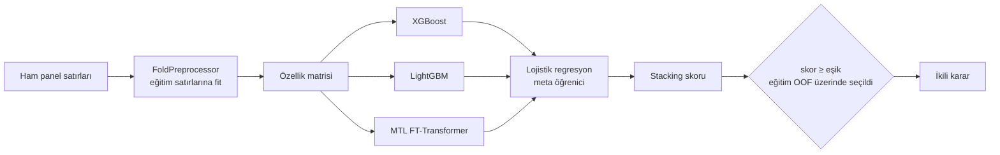
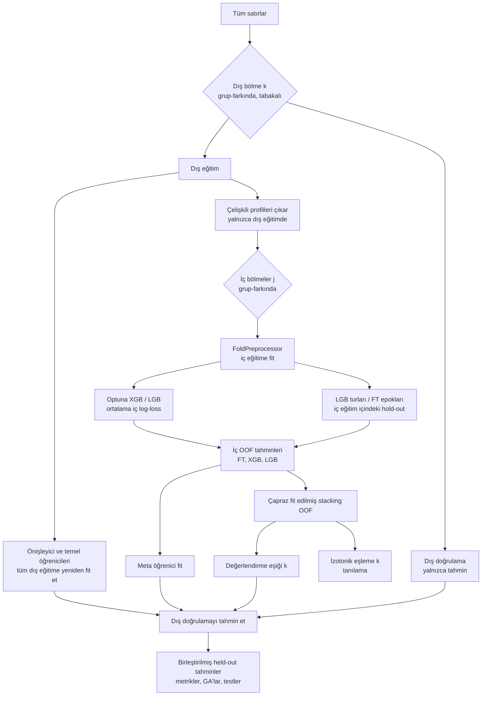

[English](README.md) | **Türkçe**

# VarPath — Missense Varyant Patojenisite Sınıflandırması

VarPath, missense varyantları patojenik ya da benign olarak skorlayan tablo verisi tabanlı bir makine öğrenmesi hattıdır. Mühendislik ürünü amino asit, yapısal ve topolojik tanımlayıcıları; gradyan artırmalı ağaçlar, çok görevli bir FT-Transformer ve lojistik regresyon tabanlı bir stacking modeliyle birleştirir. Tüm bu hat iç içe (nested), grup-farkında çapraz doğrulama ile değerlendirilir.

> **Yalnızca araştırma ve eğitim amaçlıdır. Klinik tanı, tedavi veya tıbbi karar verme amacıyla kullanılamaz.**

---

## İçindekiler

1. [Araştırma amacı](#araştırma-amacı)
2. [Yarışma bağlamı](#yarışma-bağlamı)
3. [Problem tanımı](#problem-tanımı)
4. [Veri seti](#veri-seti)
5. [Özellik mühendisliği](#özellik-mühendisliği)
6. [Model mimarisi](#model-mimarisi)
7. [Değerlendirme protokolü](#değerlendirme-protokolü)
8. [Depo yapısı](#depo-yapısı)
9. [Kurulum](#kurulum)
10. [Kullanım](#kullanım)
11. [Tekrar üretilebilirlik ve donanım](#tekrar-üretilebilirlik-ve-donanım)
12. [Sonuçlar](#sonuçlar)
13. [Metodolojik revizyon](#metodolojik-revizyon)
14. [Sınırlılıklar](#sınırlılıklar)
15. [Sorumluluk reddi](#sorumluluk-reddi)
16. [Gelecek çalışmalar](#gelecek-çalışmalar)
17. [Kaynaklar](#kaynaklar)

---

## Araştırma amacı

Proje benim yarışma prototipim olarak başladı. Bu depo onu, tek bir soruya odaklanan tekrar üretilebilir bir çalışmaya dönüştürür:

> Sabit bir özellik kümesi ve model ailesi, modellemeye ilişkin hiçbir karar değerlendirme verisine erişilerek verilmediğinde, patojenik ve benign missense varyantları ne kadar iyi ayırabilir?

Öncelik yüksek bir skor değil, savunulabilir bir performans tahminidir. Prototipin özellik mühendisliği ve model ailesi korunmuştur. Bunları çevreleyen değerlendirme süreci ise yeniden kurulmuştur (bkz. [Metodolojik revizyon](#metodolojik-revizyon)).

## Yarışma bağlamı

Bu projeyi **TEKNOFEST 2026 Sağlıkta Yapay Zeka** yarışması için kişisel bir çalışma olarak geliştirdim; yarışma, her biri bir gen paneline karşılık gelen dört etiketli eğitim tablosu sağladı. Buradaki kodun tamamı bana aittir. Colab A100 GPU üzerinde çalıştırdığım özgün notebook, bir denetim notuyla birlikte [`notebooks/legacy_competition_notebook.ipynb`](notebooks/legacy_competition_notebook.ipynb) dosyasında arşivlenmiştir.

## Problem tanımı

- **Girdi:** Her varyant için bir satır. Satırda birkaç yüz anonimleştirilmiş sayısal anotasyon, birkaç kategorik anotasyon, referans ve alternatif amino asit ile satırın geldiği panel bilgisi bulunur.
- **Çıktı:** [0, 1] aralığında bir skor ve eğitim verisi üzerinde seçilmiş bir eşikle elde edilen ikili karar (1 = patojenik, 0 = benign).
- **Değerlendirmenin hedefi:** Ayırt edicilik (ROC-AUC, PR-AUC) ve duyarlılığı önceleyen bir çalışma noktasındaki eşiğe bağlı davranış (özgüllük kısıtı altında F2).

## Veri seti

Yarışma tabloları bu depoda **yer almamaktadır**. Tablolarla birlikte bir lisans ya da yeniden dağıtım izni verilmediği için dosya yolları `.gitignore` içinde listelenmiştir. Deneyleri yeniden üretmek için dört CSV dosyasını `data/` dizinine koyun (veya `--data-dir` ile yolu verin). Beklenen yapı [`examples/DATA_SCHEMA.md`](examples/DATA_SCHEMA.md) dosyasında anlatılmaktadır. Aynı kolonlara sahip yapay bir örnek [`examples/synthetic_sample.csv`](examples/synthetic_sample.csv) dosyasında verilmiştir.

### Panel sayıları

| Panel | Satır | Patojenik | Benign | Pozitif oranı |
|---|---:|---:|---:|---:|
| MASTER | 2931 | 2149 | 782 | 0,73 |
| KANSER | 388 | 268 | 120 | 0,69 |
| PAH | 372 | 310 | 62 | 0,83 |
| CFTR | 111 | 90 | 21 | 0,81 |
| **Toplam** | **3802** | **2817** | **985** | 0,74 |

### Değerlendirmeyi şekillendiren özellikler

- **Kolonlar:** 334 `AL_*` ve 9 `EK_*` sayısal anotasyon (genelde yaklaşık %55 eksik, 57'si sabit), 6 `CAT_*` kategorik kolon ve `AA_1`/`AA_2`. Kolonlar anonimleştirilmiştir.
- **Gen, protein veya transcript kimliği yoktur.** Kolon adları ve metin değerleri gen sembolü, HGNC, UniProt, Ensembl ve RefSeq örüntüleri açısından tarandı; hiçbiri bulunmadı.
- **Paneller arası yinelenen varyantlar.** KANSER, PAH ve CFTR tablolarındaki 578 satırın `Variant_ID` değeri MASTER tablosunda da geçmektedir. Bu satırların etiketi ve amino asit değişimi aynıdır, ancak anotasyonları hafifçe perturbe edilmiştir. Toplam 3224 farklı varyant vardır.
- **Boş satırlar.** 137 satırda hiçbir sayısal bilgi yoktur ve etiketleri birbiriyle çelişmektedir.

## Özellik mühendisliği

Aşağıdaki tüm dönüşümler `src/varpath/features/` altında yer alır. Veriden öğrenen her adım, `FoldPreprocessor` içinde yalnızca eğitim bölümüne fit edilir.

| Blok | Özellik sayısı | Açıklama |
|---|---:|---|
| Özgün sayısal | değişken (sabitler çıkarıldıktan sonra ≈286) | `AL_*`, `EK_*`; MICE imputasyonu (`IterativeImputer`, en yakın 20 özellik) ve ardından `RobustScaler` |
| Amino asit fizikokimyasal | 24 | Referans kalıntı, alternatif kalıntı ve aralarındaki fark için hidropati, pI, molekül ağırlığı, hacim, polarite, yük, aromatiklik ve esneklik |
| BLOSUM62 | 1 | Yer değiştirme skoru (Henikoff & Henikoff, 1992) |
| Grantham mesafesi | 1 | Fizikokimyasal mesafe (Grantham, 1974) |
| Yapısal tanımlayıcılar | 18 | Her iki kalıntı için Chou–Fasman heliks/tabaka/dönüş eğilimleri, göreli çözücü erişilebilirliği ve rijitlik indeksi; bunların farkları; bozunum, heliks değişimi ve tabaka değişimi skorları |
| TDA | 13 | Satırın sayısal profili tek boyutlu bir sinyal olarak ele alınır, 2 boyutlu gecikme gömmesine aktarılır ve Vietoris–Rips kalıcı homolojisine (`ripser`) verilir. Özellikler H0 ve H1 için sonlu çubuk sayıları, bunların farkı ve H0 ile H1 için kalıcılığın ortalaması, maksimumu, entropisi, toplamı ve standart sapmasıdır. Boşluklar eğitim fold'unun medyanlarıyla doldurulur. |
| Eksiklik | değişken | İkili "eksik mi" bayrakları; **eğitim** etiketleriyle karşılıklı bilgisi 0,001'i aşanlar tutulur |
| Kategorik | değişken | `CAT_*` kolonlarının one-hot kodlaması (`min_frequency=3`, bilinmeyen seviyeler yok sayılır) |

Çıktı sırası `sayısal → amino asit + yapısal → TDA → eksiklik → kategorik` şeklindedir. Özellik adları modelle birlikte saklanır ve bir test, bu adların sayısının dönüştürülmüş matrisin genişliğine eşit olduğunu doğrular.

## Model mimarisi



- **XGBoost:** `hist` ağaç yöntemi ve `scale_pos_weight = 1,5 × negatif/pozitif` kullanır. Ağaç sayısı, öğrenme oranı, derinlik, satır ve kolon örnekleme ile L1/L2 cezaları üzerinde Optuna TPE araması yapılır. Derinlik, prototipteki kuralla sınırlandırılır (örnek/özellik oranı; CFTR satırları eğitim verisinin %1'inden fazlaysa üst sınır 3).
- **LightGBM:** Aynı arama uzayına `num_leaves` eklenmiştir. Satır örneklemesinin gerçekten uygulanması için `subsample_freq=1` kullanılır. Erken durdurma bir iç hold-out üzerinde yapılır ve son tur sayısı iç en iyi iterasyonların medyanıdır.
- **MTL FT-Transformer** (Gorishniy vd., 2021): Her özellik bir token'a dönüştürülür ve başa bir CLS token'ı eklenir. Ardından pre-norm bir Transformer kodlayıcı gelir (standard profilde `d_token=32`, 4 dikkat başı, 2 katman, dropout 0,3). Üstte iki çıkış başı bulunur: patojenisite (`pos_weight` ve 0,1 etiket yumuşatma ile BCE) ve panel üyeliği (çapraz entropi). Kayıplar α = 0,7 ile karıştırılır. Eğitimde AdamW (lr 3e-4) ve kosinüs öğrenme oranı planı kullanılır. İsteğe bağlı `token_budget`, eğitim fold'undaki ANOVA F skoru en yüksek k özelliği tutar; CPU için hazırlanan `quick` profilinde kullanılır.
- **Stacking:** Üç temel öğrenicinin gerçek fold-dışı (OOF) tahminleri üzerinde bir lojistik regresyon fit edilir (kolon sırası FT, XGB, LGB).

## Değerlendirme protokolü

### İç içe çapraz doğrulama



Standard profil, sabit bir tohumla (42) **5 dış × 3 iç** fold kullanır. Eğitim prosedürünün tamamı tek bir fonksiyondur: `fit_stacked_pipeline`. Bu fonksiyon her dış fold için bir kez çağrılır ve dış doğrulama satırlarını hiçbir zaman almaz. Dağıtım (deployment) modeli, aynı fonksiyonun tüm satırlarla çağrılmasıyla üretilir.

### Grup-farkında bölme

- **Gruplama değişkeni:** `Variant_ID` (`grouping.column` ile ayarlanır). Verilerde gen, protein veya transcript kimliği bulunmadığından (bkz. [Veri seti](#veri-seti)) kullanılabilecek en güçlü varlık varyantın kendisidir. Bu kolonla gruplama, paneller arası 578 yinelenen varyantı her bölmede tek bir tarafta tutar.
- **Bu nedir:** **varyant düzeyinde held-out** bir değerlendirmedir.
- **Bu ne değildir:** gen düzeyinde held-out bir değerlendirme değildir. Aynı gene ait varyantlar hem eğitim hem değerlendirme fold'larında yer alabilir; dolayısıyla görülmemiş genlerdeki performans ölçülmez.
- **Bölmelerin kurulumu:** Fold'lar mümkün olduğunda etiket × panel üzerinden tabakalandırılır. Gerekirse yalnızca etikete göre tabakalamaya, ardından karıştırılmış `GroupKFold` yöntemine geçilir.
- **Zorunlu ayrıklık:** Her dış bölme, iç bölme ve erken durdurma hold-out'u grup ayrıklığı açısından kontrol edilir; ihlal olursa çalıştırma `GroupLeakageError` ile durur. Gruplama tanımı ve fold başına kesişimler `outputs/*/group_audit.json` dosyasına yazılır.
- **Duyarlılık gruplaması:** Prototipteki sayısal profil hash'ine dayalı gruplama `configs/sensitivity_row_hash.yaml` ile hâlâ kullanılabilir. Bu bir duyarlılık analizidir, held-out değerlendirme değildir.

### Sızıntının önlenmesi

| Adım | Nerede fit edilir |
|---|---|
| Sayısal tip belirleme, sabit kolonların çıkarılması | eğitim bölümü |
| MICE imputasyonu, robust ölçekleme | eğitim bölümü |
| TDA boşluk doldurma (medyanlar), TDA ölçekleme | eğitim bölümü |
| Eksiklik göstergesi seçimi (etiket kullanır) | eğitim bölümü |
| One-hot kodlayıcılar | eğitim bölümü |
| Çelişki temizliği | eğitim bölümü (doğrulama satırları asla çıkarılmaz) |
| Sınıf ağırlıkları | eğitim bölümü |
| XGBoost / LightGBM hiperparametreleri | iç fold'lar |
| LightGBM tur sayısı, FT-Transformer epok sayısı | iç eğitim fold'ları içindeki hold-out |
| Meta öğrenici | iç OOF tahminleri |
| Karar eşiği | çapraz fit edilmiş iç OOF tahminleri |
| Yeniden kalibrasyon eşlemesi (tanılama) | çapraz fit edilmiş iç OOF tahminleri |

Test paketi bu özellikleri zorunlu kılar. Başka kontrollerin yanı sıra, dış doğrulama etiketlerinin tamamını ters çevirir ve fold'un eşiklerinin, hiperparametrelerinin, meta öğrenici katsayılarının ve held-out tahminlerinin değişmediğini doğrular. Ayrı bir test XGBoost'u "ezberleyen" bir modelle değiştirir ve hiçbir iç OOF tahmininin o satırı görmüş bir modelden gelmediğini gösterir.

### Eşik seçim protokolü

Kural prototipten korunmuştur: özgüllük en az 0,60 olacak şekilde F2'yi en büyükleyen en küçük skor eşiği seçilir.

- **Değerlendirme eşikleri** (`evaluation_fold_thresholds`): Her dış fold için bir tane. Her biri, o fold'un eğitim tarafındaki çapraz fit edilmiş stacking OOF tahminleri üzerinde seçilir ve fold'un held-out satırlarına değiştirilmeden uygulanır. İkili metrikler bu sabit kararlardan hesaplanır.
- **Dağıtım eşiği** (`deployment_threshold`): Model tüm satırlara fit edilirken aynı yolla seçilir ve `artifacts/*/manifest.json` içinde saklanır. Yalnızca çıkarımda (inference) kullanılır; performans raporlamak için asla kullanılmaz.

Held-out satırlar üzerinde hiçbir eşik ayarlanmaz; bu, tüm küme, tek bir fold veya bir panel için de geçerlidir.

### Değerlendirme metrikleri

Aşağıdaki metrikler, birleştirilmiş dış held-out tahminler üzerinde hesaplanır:

- **Eşikten bağımsız:** ROC-AUC, PR-AUC (ortalama kesinlik) ve Brier skoru.
- **Eşiğe bağlı** (fold eşikleriyle üretilen kararlardan): F1, F2, duyarlılık, özgüllük, kesinlik, NPV, MCC, dengeli doğruluk, doğruluk ve karışıklık matrisi.

Fold başına değerler `fold_metrics.csv` dosyasındadır. Panel başına değerler `panel_metrics.csv` dosyasındadır; bu dosyada örnek sayıları ve bir güvenilirlik etiketi bulunur: *single-class (AUC tanımsız)*, *exploratory (n < 30)*, *exploratory (azınlık sınıfta < 10)* veya *reportable*. Mükemmele yakın AUC değerleri öne çıkarılmaz, işaretlenir.

### Bootstrap güven aralıkları

Tüm held-out küme üzerindeki nokta tahminlerinin etrafında yüzdelik aralıklar (%95, standard profilde 1000 tekrar) hesaplanır.

- **Yeniden örnekleme birimi gruptur** (`Variant_ID`); böylece yinelenen varyantlar arasındaki korelasyon hesaba katılır.
- Olasılıklar ve ikili kararlar olduğu gibi yeniden örneklenir. Hiçbir bootstrap tekrarında eşik yeniden optimize edilmez.
- Aralıklar, eğitim prosedürünün yeniden çalıştırılmasından kaynaklanan değişkenliği içermez.

### DeLong testi

Hızlı DeLong testi (Sun & Xu, 2014), birleştirilmiş held-out olasılıklar üzerinde eşleştirilmiş ROC-AUC değerlerini karşılaştırır: XGB – LGB, XGB – stacking, LGB – stacking ve FT – stacking. Bonferroni ile düzeltilmiş α raporlanır. Test satırların bağımsız olduğunu varsayar; varyant düzeyinde gruplama bu varsayımı yalnızca yaklaşık olarak sağlar.

### McNemar testi

McNemar testi held-out ikili kararlara uygulanır; her model kendi eğitimle seçilmiş fold eşikleriyle karar üretir. Hem süreklilik düzeltmeli χ² p-değeri hem de kesin binom p-değeri verilir.

### Kalibrasyon

- **Ham tanılama:** Held-out olasılıklar üzerinde Brier skoru, beklenen kalibrasyon hatası (ECE, 10 kutu) ve güvenilirlik eğrileri.
- **Eğitim tarafında yeniden kalibrasyon:** Her dış fold'un eğitim tarafındaki çapraz fit edilmiş tahminlerine bir izotonik eşleme fit edilir ve o fold'un held-out skorlarına uygulanır. Sonuç `stack_recalibrated` olarak raporlanır.
- **Karar kuralı:** Kararlar ham stacking skoruyla verilir; böylece eşik ile kalibrasyon analizi birbirinden ayrı kalır.

### Karar eğrisi analizi

Her modelin net faydası (Vickers & Elkin, 2006), 0,01–0,80 aralığındaki eşik olasılıkları için held-out olasılıklar üzerinde hesaplanır ve "herkesi pozitif say" ile "hiç kimseyi pozitif sayma" stratejileriyle karşılaştırılır. Bu analiz bir araştırma modelinin betimsel incelemesidir; klinik fayda iddiası taşımaz.

### Açıklanabilirlik (SHAP)

Kesin TreeSHAP katkıları, **dağıtım XGBoost temel öğrenicisi** (tüm veriye yeniden fit edilmiş model) üzerinden hesaplanır. Doğrulama skoruna bakılarak herhangi bir fold modeli seçilmez.

- **Özet grafik:** Katkılar, rastgele seçilmiş eğitim satırlarından oluşan bir örneklem üzerinde hesaplanır (`shap.n_samples`).
- **Satır bazlı açıklamalar:** Çıkarım sırasında katkılar, modelin skorladığı matrisin tam kendisi üzerinde hesaplanır. Testler genişliği, özellik sırasını ve toplanabilirliği (katkılar ile sapmanın toplamı model margin değerine eşittir) doğrular.
- **Kapsam:** Açıklamalar tüm stacking modelini değil, XGBoost bileşenini betimler.

### Keşifsel analizler (birincil tahminin dışında)

- **Panele özgü ince ayar:** *Panele özgü ince ayar keşifsel niteliktedir ve birincil yansız performans tahmine dahil edilmemiştir.* Her dış fold içinde, prototipin panel kuralları o panelin dış eğitim satırlarına uygulanır: artırmaya devam etme, CFTR için ise en önemli 50 özellik üzerinde küçük bir model. Sonuçlar aynı panelin held-out satırlarında eşikten bağımsız olarak skorlanır (`exploratory_panel_finetune.csv`).
- **Varyant benzerlik ağı:** Yalnızca görsel bir özettir.

## Depo yapısı

```text
varpath/
├── README.md / README_TR.md
├── pyproject.toml, requirements.txt
├── configs/            quick.yaml, standard.yaml, full.yaml, sensitivity_row_hash.yaml
├── src/varpath/
│   ├── config.py       tipli YAML konfigürasyonu
│   ├── data.py         veri yükleme, gruplama, grup denetimi
│   ├── features/       amino_acid, structural, tda, preprocessing (FoldPreprocessor)
│   ├── models/         gbdt (hiperparametre arama), ft_transformer, stacking (fit_stacked_pipeline)
│   ├── evaluation/     splits, nested_cv, thresholding, metrics, statistics,
│   │                   calibration, dca, summary, exploratory
│   ├── reporting/      plots, report (JSON/CSV yazıcıları, araştırma PDF'i)
│   ├── artifacts.py    kaydet/yükle, VariantPredictor
│   ├── pipeline.py     uçtan uca çalıştırma
│   ├── synthetic.py    aynı yapıda yapay veri
│   └── cli.py          train / evaluate / predict giriş noktaları
├── scripts/            train.py, evaluate.py, predict.py, make_synthetic_data.py
├── app.py              Gradio demosu (kalıcı artifact'ları yükler)
├── tests/              birim testleri ve küçük uçtan uca duman (smoke) testi
├── examples/           synthetic_sample.csv, DATA_SCHEMA.md
├── notebooks/          legacy_competition_notebook.ipynb (arşivlenmiş, denetlenmiş)
└── outputs/            çalıştırma çıktıları (git tarafından yok sayılır)
```

## Kurulum

Python ≥ 3.10.

```bash
git clone <repo-url> varpath && cd varpath
python -m venv .venv && source .venv/bin/activate
# Yalnızca CPU için PyTorch (isteğe bağlı, daha küçük indirme):
pip install torch --index-url https://download.pytorch.org/whl/cpu
pip install -e ".[dev,app]"
pytest -q
```

## Kullanım

### Verinin hazırlanması

```text
data/
├── YARISMA_TRAIN_MASTER.csv
├── YARISMA_TRAIN_KANSER.csv
├── YARISMA_TRAIN_PAH.csv
└── YARISMA_TRAIN_CFTR.csv
```

Yarışma dosyaları yoksa yapay paneller şöyle üretilebilir:

```bash
python scripts/make_synthetic_data.py --out-dir data/synthetic
python scripts/train.py --config configs/quick.yaml --data-dir data/synthetic
```

### Eğitim

```bash
# iç içe değerlendirme + dağıtım modeli
python scripts/train.py --config configs/standard.yaml --data-dir data

# yalnızca değerlendirme
python scripts/train.py --config configs/standard.yaml --skip-deployment

# anlık değişiklikler
python scripts/train.py --config configs/quick.yaml --set cv.outer_folds=5 --set compute.n_jobs=4
```

### Konfigürasyon profilleri

| Ayar | `quick` | `standard` | `full` |
|---|---|---|---|
| Dış × iç fold | 3 × 2 | 5 × 3 | 5 × 5 |
| Optuna deneme sayısı (XGB / LGB) | 5 / 5 | 10 / 10 | 25 / 25 |
| Ağaç aralığı | 100–400 | 100–700 | 100–700 |
| FT `d_token`, maks. epok, sabır | 32, 15, 4 | 32, 30, 5 | 64, 50, 10 |
| FT batch / token bütçesi | 128 / 128 özellik | 128 / tümü | 64 / tümü |
| Bootstrap tekrar sayısı | 200 | 1000 | 2000 |
| SHAP örnek sayısı | 100 | 300 | 500 |
| Panel ince ayarı (keşifsel) | kapalı | açık | açık |
| Hedeflenen donanım | dizüstü CPU | CPU (yavaş) veya tek bir tüketici GPU'su | GPU |


Dördüncü bir profil olan `configs/quick_cpu.yaml`, transformer bütçesi daha da azaltılmış quick profilidir (8 epok, 96 token, tek işçi). [Sonuçlar](#sonuçlar) bölümünde raporlanan çalıştırmanın konfigürasyonudur ve tek bir CPU çekirdeğinde yaklaşık 13 dakikada tamamlanır.
Her çıktı dizini `config_used.yaml` ve `run_info.json` (profil, tohum, kütüphane sürümleri, git commit) dosyalarını içerir. Aşağıdaki sonuçlar her zaman ait oldukları profili belirtir.

### Değerlendirme

```bash
python scripts/evaluate.py --output-dir outputs/standard
```

Bu komut, tüm metrikleri, testleri ve grafikleri yeniden eğitim yapmadan `oof_predictions.csv` dosyasından yeniden hesaplar.

Çıktılar:

| Dosya | İçerik |
|---|---|
| `metrics.json` | protokol, bootstrap GA'lı birleştirilmiş held-out metrikler, kalibrasyon, eşik dağılımı |
| `fold_metrics.csv` | her model için dış fold bazında metrikler |
| `panel_metrics.csv` | örnek sayıları ve güvenilirlik etiketleriyle panel bazında metrikler |
| `thresholds.json` | `evaluation_fold_thresholds`, `deployment_threshold` |
| `statistical_tests.csv` | DeLong ve McNemar karşılaştırmaları |
| `group_audit.json` | gruplama tanımı ve fold başına grup kesişimleri |
| `oof_predictions.csv` | birleştirilmiş held-out olasılıklar, eşikler, kararlar |
| `fold_details.json` | fold başına hiperparametreler, epoklar, meta katsayılar, süreler |
| `decision_curve.csv`, `shap_importance.csv`, `exploratory_panel_finetune.csv` | destekleyici tablolar |
| `figures/` | ROC/PR, kalibrasyon, eşik analizi, panel karşılaştırması, DCA, SHAP, ağ |

### Çıkarım (inference)

```bash
python scripts/predict.py --artifacts artifacts/standard \
    --input new_variants.csv --output predictions.csv --explain 5 --report-dir reports/
```

```python
from varpath.artifacts import load_artifacts
predictor = load_artifacts("artifacts/standard")
scores = predictor.predict(df)          # skor, tahmin edilen etiket, temel model skorları
top = predictor.explain(df, top_k=5)    # XGBoost bileşeninin TreeSHAP açıklaması
```

- **Girdi:** Eğitimde görülen tüm sayısal kolonları ve `AA_1`/`AA_2` kolonlarını içermelidir. Eksik kolonlar doldurulmaz, girdi reddedilir.
- **Artifact içeriği:** önişleyici (imputer, ölçekleyiciler, kodlayıcılar, seçilmiş göstergeler), yerel formatlarında üç temel öğrenici, meta öğrenici, dağıtım eşiği, özellik şeması, gruplama bilgileri, tam konfigürasyon, tohum, kütüphane sürümleri ve SHA-256 sağlama toplamları.

### Gradio demosu

```bash
python app.py --artifacts artifacts/standard
```

- **Tam model tahmini:** Eğitim şemasına uyan bir CSV yükleyin (örneğin `examples/synthetic_sample.csv`). Her satır, kalıcı hattın tamamı ve dağıtım eşiğiyle skorlanır. Sayfa, XGBoost bileşeninin TreeSHAP katkılarını gösterir ve isteğe bağlı olarak bir araştırma PDF'i üretir.
- **Amino asit değişimi gezgini:** Bir kalıntı değişiminin tanımlayıcılarını gösterir. *Bu mod yalnızca örnekleme amaçlıdır ve tam bir model tahmini değildir.*

Demo her şeyi diskten yükler ve notebook durumuna bağlı değildir.

## Tekrar üretilebilirlik ve donanım

- **Deterministik çalışma:** Sabit bir tohum; bölmeleri, Optuna örnekleyicilerini, imputer'ları, boosting modellerini ve PyTorch'u yönetir. Her fold için alt tohumlar türetilir.
- **İmputasyon:** Deterministiktir (`sample_posterior=False`); bu nedenle bir satırın özellikleri aynı batch'teki diğer satırlara bağlı değildir.
- **Doğrulama:** Testler, aynı tohumun aynı bölmeleri ve tahminleri ürettiğini, kaydetme → yükleme işleminin skorları birebir yeniden ürettiğini doğrular.
- **Kalan deterministik olmayan kısımlar:** GPU üzerinde bazı cuDNN çekirdekleri küçük farklılıklara yol açabilir.
- **Prototipe göre hesaplama azaltımları:**
  - Profil başına arama bütçesi: 25 yerine 10 deneme.
  - FT-Transformer: `d_token` 64 yerine 32, sabırlı erken durdurma ve isteğe bağlı token bütçesi.
  - Budama: İç fold'lar boyunca Optuna medyan budaması.
  - Önbellek: TDA sonuçları, her benzersiz doldurulmuş sinyal için önbelleğe alınır.
  - Hassasiyet ve çıkarım: float32 matrisler, CUDA'da karma hassasiyet ve çıkarımda `torch.inference_mode`.
  - Paralellik: Yapılandırılabilir işçi sayısı (`compute.n_jobs`).
- **Donanım:** Hiçbir adım A100 gerektirmez. `quick` profili tek bir CPU çekirdeğinde çalışır (ölçülen süre için bkz. [Sonuçlar](#sonuçlar)). `standard` profil için tüketici sınıfı bir GPU önerilir, çünkü FT-Transformer yaklaşık 700 özellik token'ının tamamı üzerinde dikkat hesaplar. CPU'da da çalışır, yalnızca daha yavaştır.

## Sonuçlar

<!-- RESULTS-START -->
### Düzeltilmiş iç içe çapraz doğrulama (gerçekleştirilen çalıştırma)

**Değerlendirme protokolü**

```text
3 dış fold x 2 iç fold, grup-farkında (etiket x panel ile tabakalandırılmış)
Grup değişkeni: Variant_ID (varyant düzeyinde held-out; gen düzeyinde değil)
Konfigürasyon: configs/quick_cpu.yaml   Profil: quick-cpu   Tohum: 42
Tahmin: 3802 satır / 3224 grubun birleştirilmiş dış held-out tahminleri
Eşikler: her fold için dış eğitim OOF tahminlerinde seçildi (0,562; 0,595; 0,607)
```

| Metrik | İç içe grup-CV tahmini | %95 GA (grup bootstrap) |
|---|---|---|
| ROC-AUC | 0,8518 | 0,8346 – 0,8669 |
| PR-AUC | 0,9293 | 0,9181 – 0,9389 |
| F2 | 0,8984 | 0,8883 – 0,9092 |
| MCC | 0,5563 | 0,5256 – 0,5910 |
| Duyarlılık | 0,9042 | 0,8916 – 0,9161 |
| Özgüllük | 0,6345 | 0,6039 – 0,6593 |
| Dengeli doğruluk | 0,7693 | 0,7521 – 0,7861 |
| F1 | 0,8899 | — |

Tüm held-out satırlar üzerindeki karışıklık matrisi (fold eşikleriyle): TP 2547, FP 360, TN 625, FN 270.

**Aynı held-out tahminler üzerinde temel öğreniciler**

| Model | ROC-AUC | PR-AUC | F2 | MCC |
|---|---|---|---|---|
| XGBoost | 0,8534 | 0,9302 | 0,8912 | 0,5456 |
| LightGBM | 0,8510 | 0,9299 | 0,8845 | 0,5401 |
| MTL FT-Transformer | 0,7806 | 0,8964 | 0,7966 | 0,3793 |
| Stacking (LR) | 0,8518 | 0,9293 | 0,8984 | 0,5563 |

Stacking modeli AUC açısından artırmalı ağaçlardan anlamlı biçimde daha iyi değildir (DeLong, Bonferroni alfa = 0,0125: XGB – stacking p = 0,172; LGB – stacking p = 0,581). İkili kararlarında LightGBM'den ayrışır (McNemar p = 0,0038) ve tek başına transformer'dan belirgin biçimde iyidir (DeLong p < 1e-4). Transformer'ın buradaki katkısı, tek başına doğruluğu değil stacking içindeki ağırlığıdır; azaltılmış bütçeyle çalıştırılmıştır (8 epok, 96 token).

**Panel bazında** (held-out tahminler, fold eşikleri)

| Panel | n | Pozitif / Negatif | ROC-AUC | PR-AUC | F2 | MCC | Güvenilirlik |
|---|---:|---:|---|---|---|---|---|
| MASTER | 2931 | 2149 / 782 | 0,8410 | 0,9205 | 0,8882 | 0,5381 | reportable |
| KANSER | 388 | 268 / 120 | 0,9209 | 0,9552 | 0,9464 | 0,7340 | reportable |
| PAH | 372 | 310 / 62 | 0,8221 | 0,9522 | 0,9193 | 0,4089 | reportable |
| CFTR | 111 | 90 / 21 | 0,9397 | 0,9864 | 0,9263 | 0,6611 | reportable |

CFTR panelinde yalnızca 21 benign varyant bulunduğundan aralık geniştir; bu değer, modelin bu panelde daha güçlü olduğunun kanıtı olarak değil, küçük örneklem tahmini olarak okunmalıdır.

**Kalibrasyon:** Brier 0,122; ECE 0,019 (ortalama tahmin 0,729; gözlenen prevalans 0,741). Eğitim tarafında izotonik yeniden kalibrasyon tabloyu çok az değiştirir (ECE 0,017).

**Fold bazında:** ROC-AUC 0,8586 / 0,8459 / 0,8509; eşik 0,595 / 0,607 / 0,562.

**Çalışma süresi:** Tek bir CPU çekirdeğinde toplam yaklaşık 13 dakika (GPU kullanılmadı): üç dış fold için sırasıyla yaklaşık 160 sn, 153 sn ve 120 sn; dağıtım modeli için 150 sn. Dağıtım eşiği: 0,543.

> Bu, **quick-cpu** profilidir: 3x2 fold, öğrenici başına 5 Optuna denemesi ve azaltılmış transformer bütçesi. Standard profil (5x3 fold, 10 deneme, tüm özellik token'ları) henüz çalıştırılmamıştır; tam bir standard profil çalıştırması yapıldığında bu tablo onun sonuçlarıyla değiştirilecektir.
<!-- RESULTS-END -->

### Yarışma sürümü (legacy) çalıştırması

*Yarışma sürümü çalıştırması — metodolojik olarak iyimserdir, deponun birincil tahmini olarak kullanılmaz.*

| Metrik | Legacy değer |
|---|---|
| ROC-AUC | 0,8633 |
| PR-AUC | 0,9345 |
| F2 | 0,9136 |
| MCC | 0,5662 |

Bu değerler arşivlenmiş notebook'tan alınmıştır. Aşağıda sıralanan nedenlerle iç içe tahminlerle karşılaştırılabilir değildir.

Düzeltilmiş tahmin, eşikten bağımsız metriklerde bu değerlere yakın, eşiğe bağlı metriklerde daha düşüktür. Yine de ikisi karşılaştırılabilir değildir: gruplama, fold sayısı, hiperparametrelerin/epokların/eşiklerin nerede seçildiği ve arama bütçesi farklıdır. Ayrıca düzeltilmiş çalıştırma azaltılmış bir profille yapılmıştır; dolayısıyla değerleri, sızıntılı bir protokolün iyimserliğini değil, küçük bütçenin belirsizliğini taşır.

## Metodolojik revizyon

İlk sürümü yarışma takvimi baskısı altında yazdım. Değerlendirme sürecini sonradan gözden geçirdiğimde, değerlendirme fold'larından gelen bilginin modele veya çalışma noktasına ulaşabildiği birkaç nokta buldum. Depo sürümünde protokol şu şekilde değiştirildi:

| Prototip | Depo sürümü |
|---|---|
| Gruplar sayısal profilin hash'inden türetiliyordu (`hash % 200`); anotasyonları hafifçe farklı olan, aynı varyantın paneller arası kopyaları aynı gruba düşmüyordu | `Variant_ID` üzerinden, denetlenen ve her bölme düzeyinde zorunlu tutulan gruplama |
| Optuna amaç fonksiyonları dış doğrulama fold'unu skorluyordu | Optuna amaç fonksiyonları iç fold'ların ortalama log-loss değerini kullanıyor |
| LightGBM erken durdurması ve FT-Transformer epok seçimi dış doğrulama fold'unu kullanıyordu | Erken durdurma eğitim bölümü içindeki hold-out'larda yapılıyor; yeniden fit işlemleri seçilen tur/epok sayılarının medyanını kullanıyor |
| `XGBClassifier(**study.best_params)`, kütüphanelerin yok saydığı kısaltılmış Optuna anahtarlarını (`n_est`, `lr`, `md`, …) aktarıyordu; bu yüzden final modeller varsayılan hiperparametrelerle eğitildi | Parametreler gerçek adlarıyla öneriliyor ve kaydedilen modellerde doğrulanıyor |
| Meta öğrenici aynı OOF meta özellikleri üzerinde hem fit ediliyor hem değerlendiriliyordu | Meta öğrenici dış eğitim satırlarının iç OOF tahminleriyle eğitiliyor; dış satırlar yalnızca bir kez tahmin ediliyor |
| Eşik aynı tahminler üzerinde optimize edilip raporlanıyordu (genel, fold ve panel bazında) | Eşik, eğitim tarafındaki çapraz fit edilmiş tahminlerde seçilip değiştirilmeden uygulanıyor |
| Kodlayıcılar, eksiklik göstergesi seçimi, çelişki temizliği, sınıf ağırlıkları ve TDA medyanları tüm veri setini kullanıyordu | Hepsi eğitim bölümü içinde fit ediliyor |
| Panel ince ayarı, temel modelini doğrulama AUC değerine göre seçiyor ve panel doğrulama satırlarında eşik ayarlıyordu | Dış fold'ların içine yerleştirildi, eşikten bağımsız ve keşifsel olarak raporlanıyor |
| Kalibrasyon eşlemesi değerlendirme satırlarının bir alt kümesine fit ediliyordu | İzotonik eşleme eğitim tarafındaki tahminlere fit ediliyor |
| Demo iki kalıntı girdisinden yola çıkıp yaklaşık 770 özelliği medyan/sıfırla dolduruyordu; PDF'te sabit 0,514 eşiği vardı | Demo eksiksiz satırları skorluyor; tek bir kalıcı dağıtım eşiği kullanılıyor |

Revize protokolden elde edilen skorların prototipinkinden düşük olması beklenir. Depo, önceki değerlere yeniden ulaşmayı hedeflemez.

## Sınırlılıklar

- **Gen düzeyinde held-out değerlendirme yoktur.** Veride gen ya da protein kimliği bulunmadığından, varyant etkisi tahmin araçları için daha zorlu olan görülmemiş genlere genelleme (Grimm vd., 2015) ölçülmemektedir.
- **Anonim anotasyonlar.** `AL_*`/`EK_*` kolonlarının anlamı bilinmemektedir. Bazıları, örtüşen varyant veritabanlarıyla eğitilmiş başka tahmin araçlarının çıktıları olabilir; bu da her türlü tahmini şişirebilir (tip-1 döngüsellik).
- **Küçük paneller.** CFTR'de 21, PAH'ta 62 benign varyant bulunduğundan panel bazındaki eşiğe bağlı metrikler kararsızdır ve keşifsel olarak etiketlenmiştir.
- **Birleştirilmiş değerlendirme.** Fold'lar arası birleştirme beş farklı modeli bir araya getirir. Satır düzeyindeki testler (DeLong, McNemar) yinelenen varyantları bağımsız kabul eder. Küme bootstrap'ı bu sorunu yalnızca güven aralıkları için hafifletir.
- **Eğitim prosedürü varyansı.** Tohum ve Optuna kaynaklı stokastik değişkenlik aralıklara dahil değildir; birden fazla tohumla tekrarlanan iç içe CV bu değişkenliği ölçebilir.
- **Meta özellik seçim yanlılığı.** Hiperparametreler, meta özellikleri üreten iç fold'lar üzerinde seçilmektedir. Bu durum dış fold'lara dokunmaz, ancak stacking modeli ayarlanmış öğrenicilere biraz fazla güvenebilir.
- **Etiket kaynağı.** Etiketler yarışma sürümünden gelmektedir; nasıl derlendikleri ve olası etiket gürültüsü belgelenmemiştir.

## Sorumluluk reddi

**Yalnızca araştırma ve eğitim amaçlıdır. Klinik tanı, tedavi veya tıbbi karar verme amacıyla kullanılamaz.** Model dış kohortlarda doğrulanmamıştır ve bir tıbbi cihaz değildir; çıktıları hiçbir kişinin bakımına yön vermek için kullanılmamalıdır. Raporlardaki panel açıklamaları yalnızca bağlamsal bilgidir.

## Gelecek çalışmalar

- Gen kimliği içeren bir veri setinde (örneğin bir ClinVar sürümü) gen düzeyinde held-out ve zamana göre bölünmüş değerlendirme.
- Farklı tohumlarla tekrarlanan iç içe CV ile modellerin Bayesçi veya düzeltilmiş yeniden örnekleme tabanlı karşılaştırması.
- Anonim anotasyonların, belgelenmiş ve döngüsellik açısından taranmış kaynaklarla değiştirilmesi.
- Olasılık kalibrasyonunun dağıtılan modelin bir parçası hâline getirilmesi ve iç içe biçimde değerlendirilmesi.
- Panel boyutları yeterli olduğunda, tam iç içe protokol altında eğitilen panele özgü modeller.

## Kaynaklar

1. Gorishniy, Y., Rubachev, I., Khrulkov, V., Babenko, A. (2021). Revisiting deep learning models for tabular data. *NeurIPS*.
2. Chen, T., Guestrin, C. (2016). XGBoost: A scalable tree boosting system. *KDD*.
3. Ke, G. vd. (2017). LightGBM: A highly efficient gradient boosting decision tree. *NeurIPS*.
4. Wolpert, D. H. (1992). Stacked generalization. *Neural Networks*, 5(2).
5. Varma, S., Simon, R. (2006). Bias in error estimation when using cross-validation for model selection. *BMC Bioinformatics*, 7:91.
6. Cawley, G. C., Talbot, N. L. C. (2010). On over-fitting in model selection and subsequent selection bias in performance evaluation. *JMLR*, 11.
7. Grimm, D. G. vd. (2015). The evaluation of tools used to predict the impact of missense variants is hindered by two types of circularity. *Human Mutation*, 36(5).
8. DeLong, E. R., DeLong, D. M., Clarke-Pearson, D. L. (1988). Comparing the areas under two or more correlated ROC curves. *Biometrics*, 44(3).
9. Sun, X., Xu, W. (2014). Fast implementation of DeLong's algorithm for comparing the areas under correlated ROC curves. *IEEE Signal Processing Letters*, 21(11).
10. McNemar, Q. (1947). Note on the sampling error of the difference between correlated proportions or percentages. *Psychometrika*, 12(2).
11. Efron, B., Tibshirani, R. J. (1993). *An Introduction to the Bootstrap*. Chapman & Hall.
12. Vickers, A. J., Elkin, E. B. (2006). Decision curve analysis: a novel method for evaluating prediction models. *Medical Decision Making*, 26(6).
13. Lundberg, S. M., Lee, S.-I. (2017). A unified approach to interpreting model predictions. *NeurIPS*.
14. Lundberg, S. M. vd. (2020). From local explanations to global understanding with explainable AI for trees. *Nature Machine Intelligence*, 2.
15. Akiba, T. vd. (2019). Optuna: A next-generation hyperparameter optimization framework. *KDD*.
16. van Buuren, S., Groothuis-Oudshoorn, K. (2011). mice: Multivariate imputation by chained equations in R. *Journal of Statistical Software*, 45(3).
17. Grantham, R. (1974). Amino acid difference formula to help explain protein evolution. *Science*, 185(4154).
18. Henikoff, S., Henikoff, J. G. (1992). Amino acid substitution matrices from protein blocks. *PNAS*, 89(22).
19. Chou, P. Y., Fasman, G. D. (1978). Prediction of the secondary structure of proteins from their amino acid sequence. *Advances in Enzymology*, 47.
20. Edelsbrunner, H., Harer, J. (2010). *Computational Topology: An Introduction*. AMS.
21. Bauer, U. (2021). Ripser: efficient computation of Vietoris–Rips persistence barcodes. *Journal of Applied and Computational Topology*, 5.
